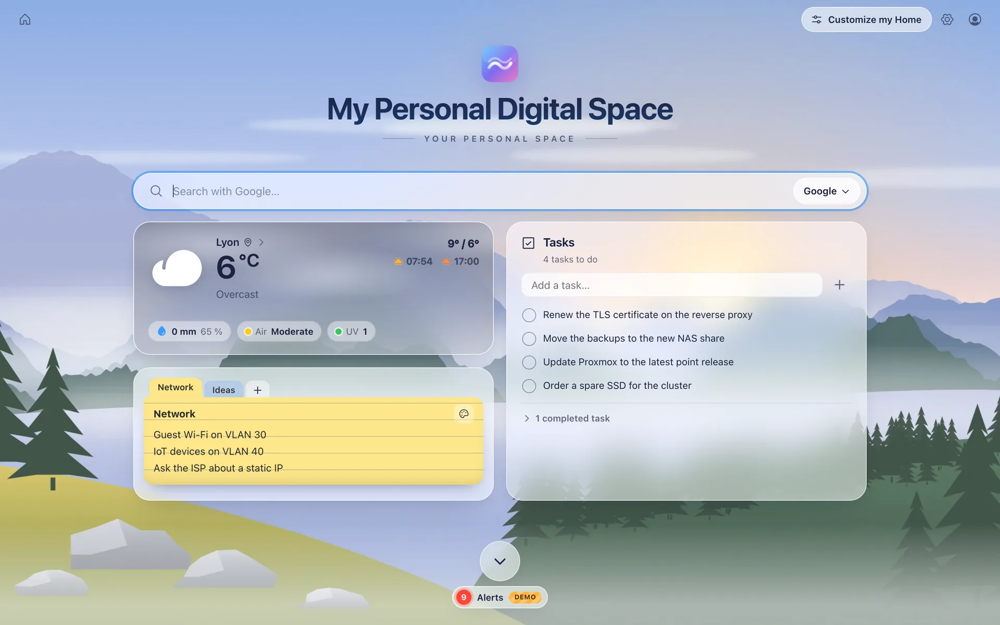
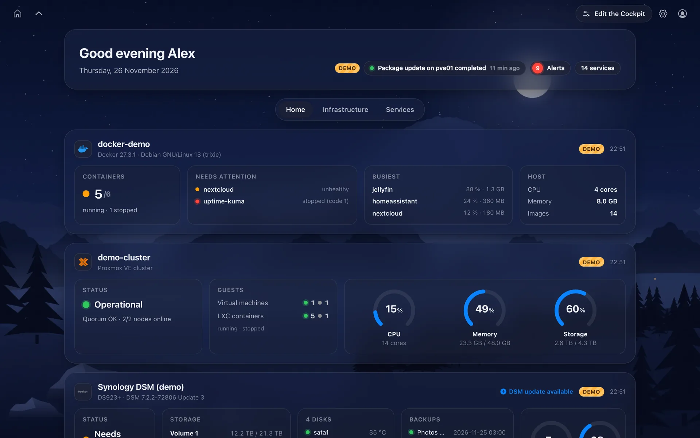

# My Personal Digital Space (MyPDS)

**Une page d'accueil pour mon quotidien. Un cockpit pour mon homelab. Le tout chez moi, sous mon contrôle.**

[English version](README.md)



---

## Pourquoi ce projet ?

J'aime l'informatique, les infrastructures, le homelab et tout ce qui permet de construire son propre environnement numérique.

Au fil du temps, j'ai installé, testé et utilisé pas mal d'outils pour superviser mes machines, gérer mes services ou simplement retrouver les informations dont j'ai besoin au quotidien.

Mais il me manquait toujours quelque chose.

Quand j'ouvre mon navigateur, je n'ai pas forcément envie de tomber sur un tableau de bord rempli de graphiques, de statistiques et de voyants lumineux. J'aimerais simplement retrouver ma recherche, la météo, mes prochains rendez-vous, quelques actualités et les informations qui comptent pour moi.

Et quand j'ai besoin de surveiller mon infrastructure, je veux pouvoir accéder à une véritable vue d'ensemble de mon homelab : Proxmox, Docker, Synology, UniFi et les services qui tournent chez moi.

J'ai cherché une solution qui réunisse ces deux besoins. Je n'ai pas vraiment trouvé ce que j'avais en tête.

Alors j'ai décidé de la construire.

**My Personal Digital Space, ou MyPDS, est né de cette envie : avoir un espace numérique qui me ressemble, qui soit agréable à utiliser tous les jours et qui me permette de garder un œil sur mon infrastructure sans multiplier les applications.**

Ce projet est avant tout un projet personnel, développé pour répondre à un besoin réel. Mais si d'autres personnes y trouvent leur compte, ce sera encore mieux !

## Deux espaces, une seule application

MyPDS repose sur deux univers volontairement distincts.

### 1. La Home — Mon espace personnel

C'est la première chose que je vois en ouvrant mon navigateur.

Je voulais quelque chose de simple, reposant et personnalisable. Pas une succession de tuiles imposées, mais un espace que chacun peut organiser à sa façon.

On y retrouve notamment :

- **Recherche :** Google, Bing, DuckDuckGo, Qwant ou un moteur personnalisé.
- **Météo :** conditions actuelles, vent, pluie, qualité de l'air et indice UV, avec Open-Meteo.
- **Agenda :** récupération des rendez-vous depuis des calendriers ICS, y compris protégés par authentification.
- **Actualités :** flux RSS et Atom, avec import des abonnements OPML. Je souhaite notamment pouvoir retrouver les flux que j'utilise déjà dans NetNewsWire.
- **Tâches :** listes de tâches avec conservation de l'historique des éléments terminés.
- **Post-it :** notes personnelles avec onglets, couleurs et textures de papier.

La disposition est libre : on peut ajouter, déplacer, redimensionner ou masquer les widgets.

La version mobile possède sa propre disposition, indépendante de celle de l'ordinateur. L'idée est de retrouver son environnement sur iPhone sans simplement subir une version desktop réduite.

### 2. Le Digital Cockpit — Mon homelab sous les yeux

C'est l'autre partie du projet.



*Captures prises en mode démonstration : tous les chiffres et les noms sont fictifs.*

Quand je veux savoir ce qui se passe sur mon infrastructure, je retrouve une vue d'ensemble de mes équipements et de mes services.

Je ne voulais pas d'un écran qui affiche tout en permanence. Les informations essentielles doivent être visibles rapidement, et les détails accessibles lorsqu'on en a besoin.

Le cockpit repose sur des groupes, des lignes et des tuiles que chacun peut organiser.

Sur mobile, les groupes restent indépendants : les éléments d'une même ligne s'empilent verticalement, sans se mélanger avec les groupes suivants.

### Les connecteurs

| Connecteur    | Informations disponibles                                                | État         |
| ------------- | ----------------------------------------------------------------------- | ------------ |
| Proxmox VE    | Clusters, quorum, nœuds, VM, LXC, CPU, mémoire, stockage et sauvegardes | Testé        |
| UniFi Network | Passerelle, débit Internet, équipements, clients et mises à jour        | Testé        |
| Synology DSM  | Disques, RAID, volumes, températures, ventilateurs et Hyper Backup      | Expérimental |
| Docker        | Conteneurs, état de santé, CPU et mémoire                               | Expérimental |

Les connecteurs marqués comme expérimentaux ont été développés et testés en environnement de développement, mais je n'ai pas encore validé leur fonctionnement sur mon matériel réel.

Si vous disposez d'un Synology ou d'un environnement Docker conséquent, vos retours et vos tests seront particulièrement appréciés.

Chaque connecteur dispose également d'un mode démonstration. Il permet de découvrir l'interface et de manipuler les différentes vues avec des données fictives, clairement identifiées comme telles.

## Une interface qui me ressemble

Je passe beaucoup de temps devant mes écrans. J'avais donc envie de construire quelque chose que j'aurais réellement plaisir à utiliser.

J'aime les interfaces épurées, les environnements Apple, les fonds naturels et les effets de transparence bien dosés.

C'est ce qui a guidé la direction graphique de MyPDS :

- Glassmorphism et surfaces translucides.
- Fonds d'écran personnalisables.
- Thèmes clairs et sombres.
- Ambiances Nature, Abstrait, Minimaliste et IT.
- Flou et transparence réglables.
- Couleurs d'accentuation personnalisables.
- Interface française et anglaise.

L'objectif est simple : avoir une interface élégante sans sacrifier la lisibilité ni les informations techniques.

## Et côté technique ?

Je souhaitais également que l'installation reste accessible et que l'application puisse fonctionner sur une petite machine.

MyPDS est conçu pour être auto-hébergé.

Dans mon cas, le choix est de l'installer dans un conteneur LXC Debian sur Proxmox, sans avoir besoin de Docker à l'intérieur du conteneur.

L'application fonctionne comme un service indépendant et communique avec les équipements de l'infrastructure via leurs interfaces respectives.

### Technologies utilisées

| Composant       | Technologie                |
| --------------- | -------------------------- |
| Backend         | Python / FastAPI           |
| Frontend        | Vue 3 / TypeScript / Vite  |
| Base de données | PostgreSQL                 |
| Communication   | API REST                   |
| Exécution       | systemd                    |
| Hébergement     | Debian dans un LXC Proxmox |

Les choix d'architecture sont documentés dans [`docs/adr/`](docs/adr/README.md), et une vue d'ensemble est disponible dans [`docs/architecture.md`](docs/architecture.md).

## La sécurité avant tout

Un outil qui connaît l'état de mon infrastructure et qui possède les identifiants de mes équipements doit être conçu sérieusement.

J'ai donc fait le choix de limiter volontairement les possibilités d'action.

**Les connecteurs sont en lecture seule. MyPDS ne démarre, n'arrête et ne modifie aucun équipement.**

Quelques principes appliqués au projet :

- Identifiants chiffrés en AES-256-GCM.
- Clé de chiffrement conservée hors de la base de données.
- Aucun identifiant d'équipement transmis au navigateur.
- Sessions gérées côté serveur.
- Protection CSRF.
- Content Security Policy.
- Limitation des tentatives de connexion.
- Protection contre les attaques SSRF sur les flux et calendriers.
- Vérification des certificats TLS, y compris pour les équipements utilisant des certificats auto-signés, avec possibilité d'épingler leur certificat.

MyPDS est pensé pour fonctionner sur un réseau local ou derrière un VPN, avec un reverse proxy devant.

Je déconseille fortement de l'exposer directement sur Internet.

Les informations détaillées sont disponibles dans [`SECURITY.md`](SECURITY.md).

## Installation

L'objectif est de pouvoir installer MyPDS directement depuis un poste Linux ou macOS, sans devoir préparer manuellement un environnement complet.

### Prérequis

- Un serveur Proxmox VE.
- Un accès SSH au serveur.
- Un poste macOS ou Linux.
- Python 3.13.
- Node.js 22.

### Installation rapide

```bash
git clone https://github.com/skidtek/mypds.git
cd mypds

scripts/deploy-proxmox.sh root@votre-noeud-proxmox
```

Le script se charge de construire la release, de créer un conteneur Debian 13 non privilégié, d'installer MyPDS et de demander le mot de passe administrateur.

Comptez environ cinq minutes selon votre environnement et votre connexion.

### Essayer sans tout installer

Vous souhaitez simplement découvrir l'application ?

Un mode léger permet de créer un petit conteneur de démonstration avec des connecteurs utilisant des données fictives.

```bash
scripts/deploy-proxmox.sh root@votre-noeud-proxmox --light
```

Configuration prévue : 1 vCPU et 1 Go de RAM.

L'installation manuelle, le reverse proxy, les mises à jour, les sauvegardes et la désinstallation sont documentés dans [`docs/install.md`](docs/install.md).

La configuration des connecteurs et les permissions nécessaires sont détaillées dans [`docs/connectors.md`](docs/connectors.md).

## Ce qui reste à construire

MyPDS est un projet qui va évoluer. Je préfère avancer progressivement, tester les fonctionnalités et améliorer ce qui existe plutôt que d'accumuler des intégrations sans prendre le temps de les fiabiliser.

Les prochaines évolutions envisagées :

- Consolider les connecteurs Synology et Docker sur du matériel réel.
- Enrichir l'historique des métriques.
- Améliorer les notifications et les alertes.
- Ajouter de nouveaux connecteurs.
- Continuer à travailler sur l'expérience mobile.
- Faire évoluer les possibilités de personnalisation.

La roadmap évoluera avec les retours et les besoins rencontrés pendant l'utilisation.

## Contribuer

Même si le projet est né de mon propre usage, je serais ravi de voir d'autres personnes s'y intéresser.

Si vous avez des idées, des remarques, des suggestions d'amélioration ou simplement envie de tester un connecteur, n'hésitez pas !

Les contributions sont les bienvenues :

- Signaler un bug.
- Proposer une évolution.
- Suggérer un nouveau connecteur.
- Améliorer la documentation.
- Participer aux traductions.
- Proposer une Pull Request.

Les modalités sont détaillées dans [`CONTRIBUTING.md`](CONTRIBUTING.md).

Pour les vulnérabilités de sécurité, merci de suivre la procédure indiquée dans [`SECURITY.md`](SECURITY.md) plutôt que de publier un problème sensible directement dans les issues.

## Licence

MyPDS est distribué sous licence **GNU Affero General Public License v3.0 ou ultérieure (AGPL-3.0-or-later)**.

Je souhaite que le projet reste libre : vous pouvez l'utiliser, l'étudier, le modifier et le redistribuer dans le respect de cette licence.

Si vous proposez une version modifiée sous forme de service accessible sur un réseau, les obligations de partage du code source prévues par l'AGPL s'appliquent également.

## Remerciements et crédits

Quelques projets et ressources contribuent à MyPDS :

- [Open-Meteo](https://open-meteo.com/) — données météorologiques, licence CC BY 4.0.
- [Simple Icons](https://simpleicons.org/) — icônes de marques, licence CC0.

Les marques et logos restent la propriété de leurs détenteurs respectifs.

---

**Merci d'être passé par ici !**

Si MyPDS vous est utile, si vous avez envie de le tester ou simplement de suivre son évolution, n'hésitez pas à mettre une étoile au dépôt.

Et si vous avez des idées pour le faire évoluer, je serai ravi d'en discuter.

À bientôt sur MyPDS !
