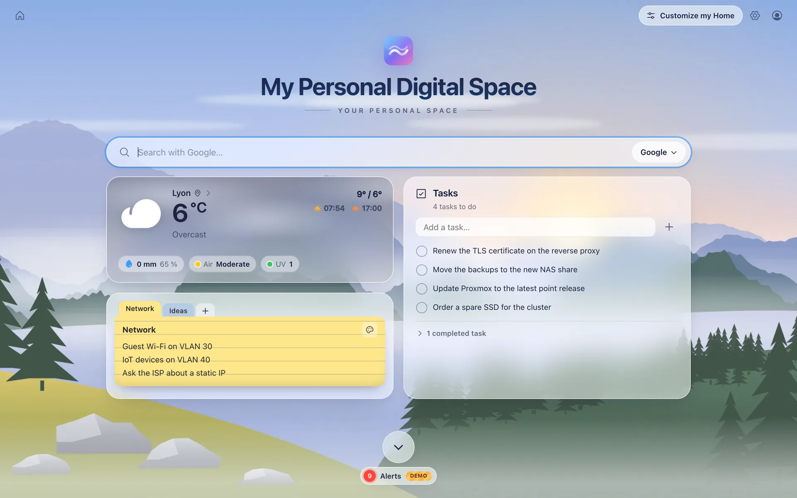
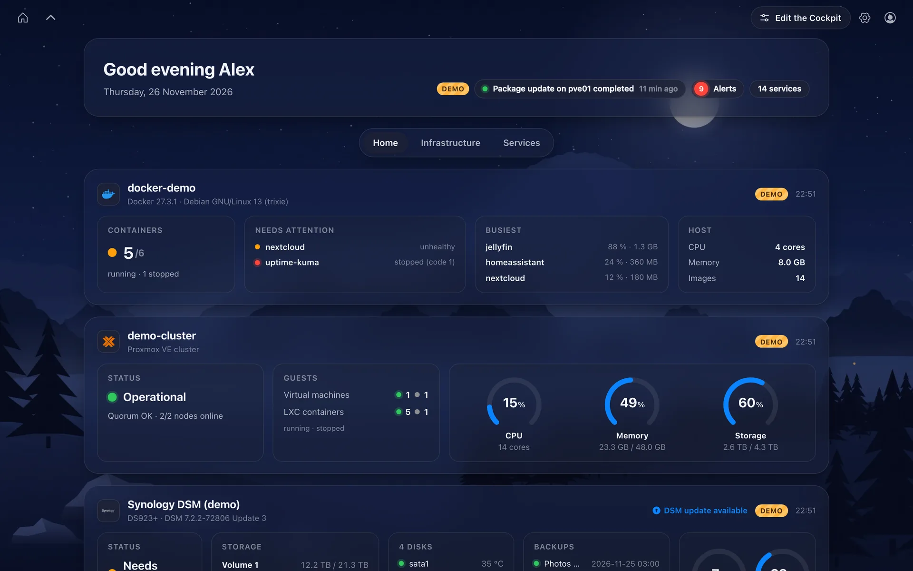

# My Personal Digital Space (MyPDS)

**A start page for my everyday life. A cockpit for my homelab. All of it at home, under my control.**

[Version française](README.fr.md)



---

## Why this project?

I love computers, infrastructure, homelabs and anything that lets you build your own digital environment.

Over the years, I've installed, tested and used quite a few tools to monitor my machines, manage my services, or simply find the information I need day to day.

But something was always missing.

When I open my browser, I don't necessarily want to land on a dashboard full of charts, statistics and blinking lights. I just want my search bar, the weather, my upcoming appointments, a few headlines, and the information that matters to me.

And when I need to keep an eye on my infrastructure, I want a real overview of my homelab: Proxmox, Docker, Synology, UniFi, and the services running at home.

I looked for something that would do both. I never quite found what I had in mind.

So I decided to build it.

**My Personal Digital Space, or MyPDS, grew out of that wish: a digital space that feels like mine, that's pleasant to use every day, and that lets me keep an eye on my infrastructure without juggling a dozen apps.**

This is first and foremost a personal project, built to meet a real need. But if other people find it useful too, even better!

## Two spaces, one app

MyPDS is built around two deliberately separate worlds.

### 1. Home: my personal space

It's the first thing I see when I open my browser.

I wanted something simple, calm and customizable. Not a fixed wall of tiles, but a space everyone can arrange their own way.

You'll find:

- **Search:** Google, Bing, DuckDuckGo, Qwant or a custom engine.
- **Weather:** current conditions, wind, rain, air quality and UV index, from Open-Meteo.
- **Calendar:** appointments from ICS calendars, including password-protected ones.
- **News:** RSS and Atom feeds, with OPML import. In particular, I wanted to bring over the feeds I already follow in NetNewsWire.
- **Tasks:** to-do lists that keep a history of completed items.
- **Sticky notes:** personal notes with tabs, colors and paper textures.

The layout is free: add, move, resize or hide widgets as you like.

The mobile version has its own layout, separate from the desktop one. The idea is to find your own space on an iPhone, rather than putting up with a shrunken desktop page.

### 2. The Digital Cockpit: my homelab at a glance

This is the other half of the project.



*Screenshots taken in demo mode: every number and name is fake.*

When I want to know what's happening on my infrastructure, I get an overview of my devices and services.

I didn't want a screen that shows everything all the time. The essentials should be visible at a glance, and the details available when you need them.

The cockpit is made of groups, rows and tiles that you can arrange.

On mobile, groups stay separate: the items in a row stack vertically, without mixing with the groups below.

### Connectors

| Connector     | Available information                                                      | Status       |
| ------------- | -------------------------------------------------------------------------- | ------------ |
| Proxmox VE    | Clusters, quorum, nodes, VMs, LXCs, CPU, memory, storage and backups       | Tested       |
| UniFi Network | Gateway, Internet throughput, devices, clients and updates                 | Tested       |
| Synology DSM  | Disks, RAID, volumes, temperatures, fans and Hyper Backup                  | Experimental |
| Docker        | Containers, health, CPU and memory                                         | Experimental |

The connectors marked experimental were built and tested in a development environment, but I haven't validated them on my own hardware yet.

If you have a Synology or a sizable Docker setup, your feedback and testing would be especially welcome.

Every connector also has a demo mode. It lets you explore the interface and play with the different views using fake data, clearly labeled as such.

## An interface that feels like me

I spend a lot of time in front of screens, so I wanted to build something I'd genuinely enjoy using.

I like clean interfaces, the Apple look and feel, natural backgrounds and well-balanced transparency effects.

That's what shaped the look of MyPDS:

- Glassmorphism and translucent surfaces.
- Custom wallpapers.
- Light and dark themes.
- Nature, Abstract, Minimal and IT backgrounds.
- Adjustable blur and transparency.
- Custom accent colors.
- French and English interface.

The goal is simple: an elegant interface that doesn't sacrifice readability or technical information.

## Under the hood

I also wanted installation to stay approachable, and the app to run on a small machine.

MyPDS is designed to be self-hosted.

In my case, I chose to install it in a Debian LXC container on Proxmox, with no need for Docker inside the container.

The app runs as a standalone service and talks to your infrastructure through each device's own interface.

### Tech stack

| Component | Technology                  |
| --------- | --------------------------- |
| Back end  | Python / FastAPI            |
| Front end | Vue 3 / TypeScript / Vite   |
| Database  | PostgreSQL                  |
| API       | REST                        |
| Runtime   | systemd                     |
| Hosting   | Debian in a Proxmox LXC     |

Architecture decisions are documented in [`docs/adr/`](docs/adr/README.md), and an overview is available in [`docs/architecture.md`](docs/architecture.md).

## Security first

A tool that knows the state of my infrastructure and holds the credentials to my devices has to be built carefully.

So I chose to deliberately limit what it can do.

**Connectors are read-only. MyPDS never starts, stops or changes any device.**

A few principles applied throughout the project:

- Credentials encrypted with AES-256-GCM.
- Encryption key kept outside the database.
- No device credential is ever sent to the browser.
- Server-side sessions.
- CSRF protection.
- Content Security Policy.
- Login rate limiting.
- SSRF protection for feeds and calendars.
- TLS certificate verification, including for devices with self-signed certificates, which you can pin.

MyPDS is meant to run on a local network or behind a VPN, with a reverse proxy in front.

I strongly advise against exposing it directly to the Internet.

Details are in [`SECURITY.md`](SECURITY.md).

## Installation

The goal is to install MyPDS straight from a Linux or macOS machine, without having to prepare a whole environment by hand.

### Requirements

- A Proxmox VE server.
- SSH access to the server.
- A macOS or Linux machine.
- Python 3.13.
- Node.js 22.

### Quick install

```bash
git clone https://github.com/skidtek/mypds.git
cd mypds

scripts/deploy-proxmox.sh root@your-proxmox-node
```

The script builds the release, creates an unprivileged Debian 13 container, installs MyPDS and asks for the admin password.

Allow about five minutes, depending on your setup and connection.

### Try it without the full install

Just want to look around?

A light mode creates a small demo container with connectors that use fake data.

```bash
scripts/deploy-proxmox.sh root@your-proxmox-node --light
```

Planned size: 1 vCPU and 1 GB of RAM.

Manual installation, the reverse proxy, updates, backups and uninstalling are covered in [`docs/install.md`](docs/install.md).

Connector setup and the permissions they need are detailed in [`docs/connectors.md`](docs/connectors.md).

## What's next

MyPDS will keep evolving. I'd rather move step by step, test features and improve what exists than pile up integrations without taking the time to make them reliable.

Planned next steps:

- Harden the Synology and Docker connectors on real hardware.
- Richer metric history.
- Better notifications and alerts.
- New connectors.
- Keep improving the mobile experience.
- More customization options.

The roadmap will follow feedback and the needs that come up in everyday use.

## Contributing

Even though the project grew out of my own needs, I'd be delighted to see others take an interest.

If you have ideas, feedback, suggestions, or just want to test a connector, go for it!

Contributions are welcome:

- Report a bug.
- Suggest an improvement.
- Propose a new connector.
- Improve the documentation.
- Help with translations.
- Open a pull request.

Details are in [`CONTRIBUTING.md`](CONTRIBUTING.md).

For security vulnerabilities, please follow the process described in [`SECURITY.md`](SECURITY.md) rather than posting a sensitive issue publicly.

## License

MyPDS is released under the **GNU Affero General Public License v3.0 or later (AGPL-3.0-or-later)**.

I want the project to stay free: you can use, study, modify and redistribute it under the terms of this license.

If you offer a modified version as a service over a network, the AGPL's source-sharing obligations apply as well.

## Thanks and credits

A few projects and resources help make MyPDS:

- [Open-Meteo](https://open-meteo.com/): weather data, CC BY 4.0 license.
- [Simple Icons](https://simpleicons.org/): brand icons, CC0 license.

Trademarks and logos remain the property of their respective owners.

---

**Thanks for stopping by!**

If MyPDS is useful to you, if you'd like to try it, or just want to follow along, feel free to star the repository.

And if you have ideas to take it further, I'd love to talk about them.

See you on MyPDS!
